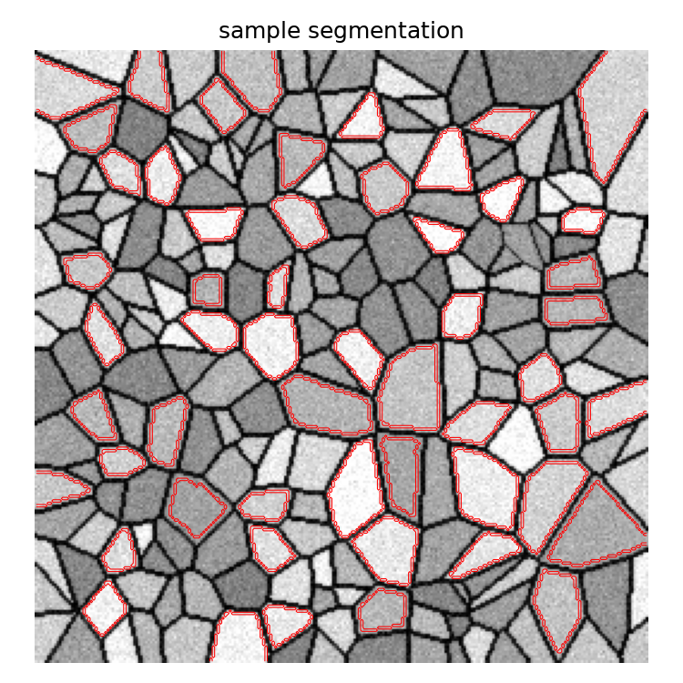
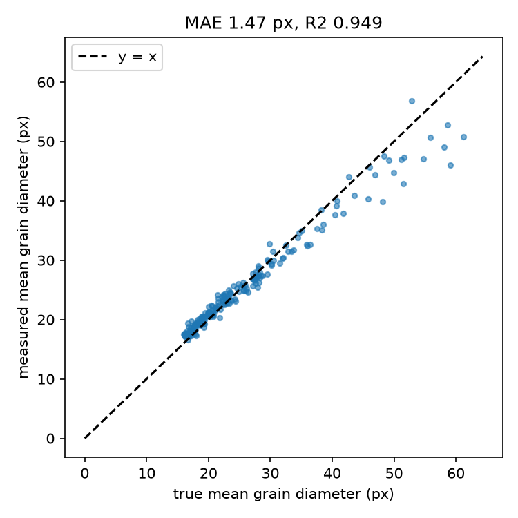
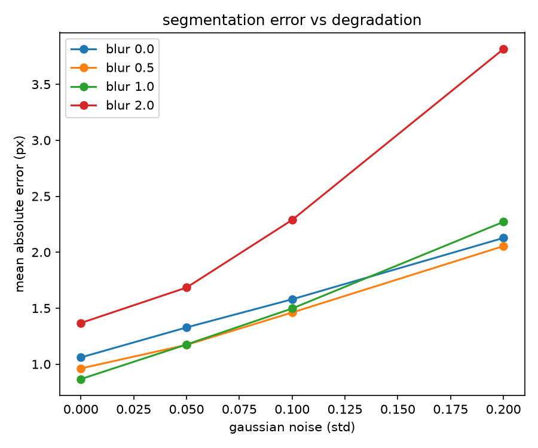
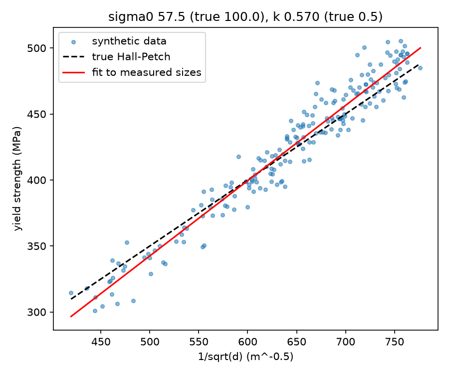

# Steel Microstructure CV: Synthetic Micrograph Segmentation & Hall-Petch Analysis

Computer vision pipeline generating synthetic Voronoi steel micrographs, segmenting grain boundaries via Otsu thresholding + Watershed, and measuring grain size distributions with empirical Hall-Petch bias analysis.






## Overview

- **Micrograph Generator**: Synthesizes realistic 2D Voronoi grain structures with variable grain seed densities, boundary rendering, Gaussian blur, and additive sensor noise (`gen.py`).
- **Segmentation & Measurement**: Classical computer vision pipeline using distance transforms, peak local maxima markers, and watershed segmentation to extract equivalent grain diameters (`measure.py`).
- **Degradation Sweeps**: Evaluates measurement resilience under varying Gaussian blur and noise intensities.
- **Hall-Petch Fitting & Error Analysis**: Demonstrates systematic measurement compression (overestimating fine grains, underestimating coarse grains) and its downstream impact on physical parameter estimation ($\sigma_0, k$).

## Quickstart

```bash
python -m venv .venv
# On Windows: .venv\Scripts\activate
# On Linux/macOS: source .venv/bin/activate
pip install -r requirements.txt

# Run generation and analysis pipeline
python run_p4.py
```

## Key Results

- **Segmentation Accuracy**: 200/200 synthetic images evaluated: MAE = 1.47 px, $R^2 = 0.949$.
- **Sensor Degradation**: MAE increases from 1.06 px (baseline) to 3.81 px under noise $\sigma=0.2$ and blur $\sigma=2.0$ (blur found to be the primary failure mode).
- **Hall-Petch Fitting**: True parameters ($\sigma_0 = 100 \text{ MPa}, k = 0.50 \text{ MPa}\cdot\text{m}^{0.5}$) fit from measured values yield $\sigma_0 = 57.5 \text{ MPa}, k = 0.570 \text{ MPa}\cdot\text{m}^{0.5}$ due to errors-in-variables compression bias.
